<!-- Cards are rendered by scripts/render_cards.py; the block below is rewritten on every run. -->
<!-- cards:start -->

<!-- cards:end -->

More: <a href="EXPERIENCE.md">Experience</a> · <a href="PROJECTS_SHOWCASE.md">Projects</a> · <a href="CERTIFICATIONS.md">Certifications</a> 
Cards redraw daily from GitHub data. Type: Soria by Bydani (CC BY-ND 4.0) and Vercetti by Filippos Fragkogiannis &amp; Richard Mandona.

